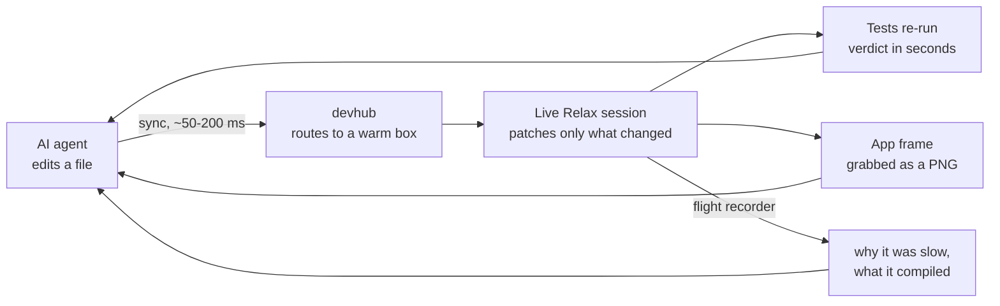
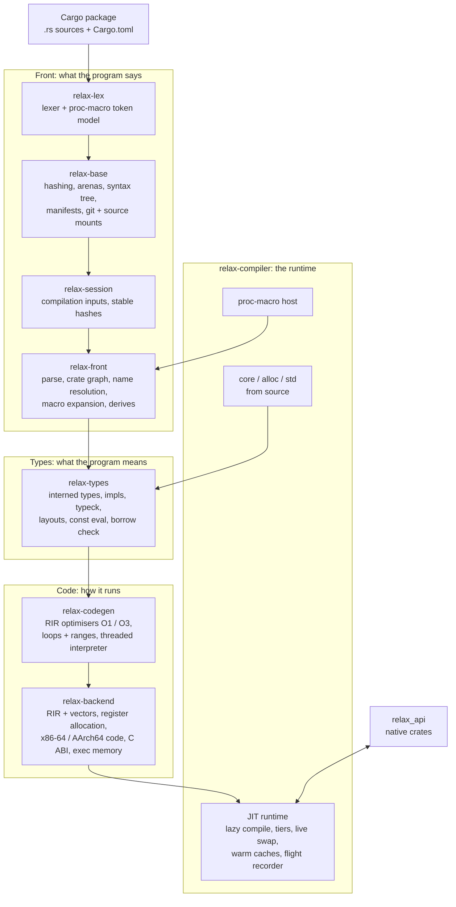
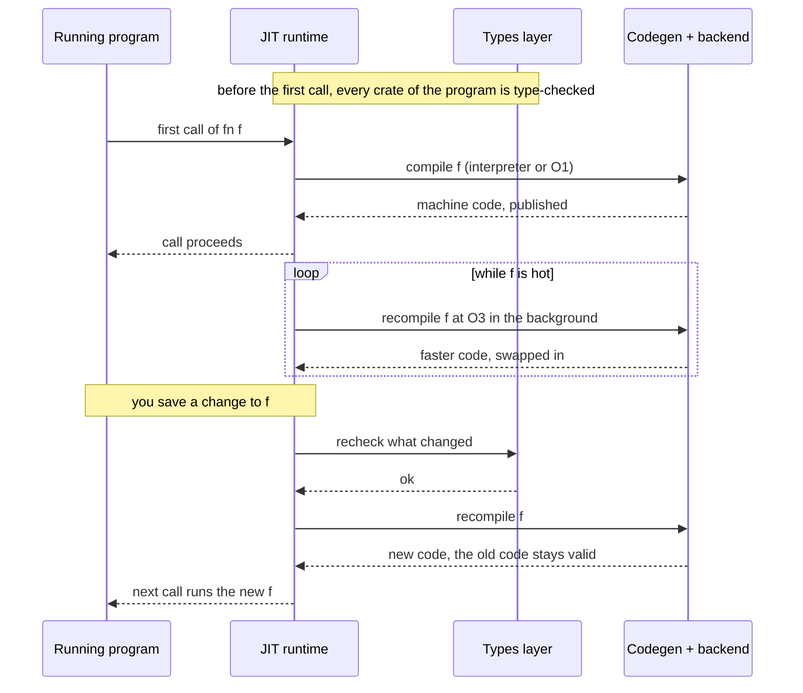

# Relax

### Rust without the wait.

**rustc builds your program, then you run it. Relax runs your program while it builds it.**

Relax is a live compiler and JIT runtime for Rust, written in Rust. It runs a Cargo package straight
from source, with no rustc, LLVM or linker in the loop. It checks your code, compiles each function the
moment it is first called, optimises the hot ones while the program runs, and patches new code into the
running process when you save a file.

**TL;DR** Rust's speed and safety, without the compile-time wait.

- **What:** a live compiler and JIT runtime for Rust that runs a Cargo package straight from source. No rustc, no LLVM, no linker.
- **Start:** on an M4 MacBook a large 3D game shows its first frame **11 s** after a clean checkout, where rustc builds for ~3 min first. The second run takes **1.15 s**.
- **Change:** save a file and the changed functions are patched into the running program, state kept. **92 tests re-run in 2.2 s.**
- **Speed:** optimised code runs at **1.14–1.26×** rustc `--release` (native CPU) on real workloads. See [where LLVM still wins](#where-llvm-still-wins).
- **Size:** one Rust library: **438k lines, 0 crates.io dependencies.**

## Relax vs rustc

| | rustc + Cargo | **Relax** |
| --- | --- | --- |
| **Large 3D game, clean checkout → first frame** | ~3 min build, then start | **11 s** on an M4 MacBook, straight from source |
| **Same game, second run → first frame** | start the built binary | **1.15 s** on an M4 MacBook, nothing recompiled |
| **Change one function in a running program** | rebuild, relink, restart: program state lost | **patched into the running process**: state kept |
| **Save a file → 92 tests re-run** | rebuild the test binary first | **2.2 s** after the save |
| **Small app, cold → first frame** | build it first | **3.7 s** cold, **0.41 s** warm (M4 MacBook) |
| **Speed of optimised code** | 1.00× (LLVM, `--release` for the native CPU) | **1.14–1.26×** on real workloads; 2.3× on dense numeric loops, which it doesn't vectorise yet ([details](#where-llvm-still-wins)) |
| **Type- and borrow-checked before it runs** | yes | **yes** |
| **Needs** | rustc, LLVM, a linker | **Relax**, one Rust library (438k lines, 0 crates.io dependencies) |

### What it took: a new Rust toolchain, from source bytes to machine code

Relax isn't a wrapper around rustc or a plugin for LLVM. It replaces both, plus the parts of Cargo and the
linker that sit between your source and a running program, in one Rust library with no dependencies.

| The job | In the usual toolchain | **In Relax** |
| --- | --- | --- |
| Lex, parse and expand macros, `macro_rules!` and procedural | rustc | **relax-lex, relax-front** |
| Resolve names, solve traits, infer types, check borrows, evaluate constants | rustc | **relax-types** |
| Optimise: inlining, folding, loops, ranges | rustc's MIR passes + LLVM | **relax-codegen** (O1 and O3) |
| Allocate registers, emit x86-64 and AArch64 machine code | LLVM | **relax-backend** |
| Link and load | the system linker and loader | **relax-compiler**, straight into executable memory |
| Read manifests and resolve the crate graph | Cargo | **relax-base** |
| Build `core`, `alloc` and `std` | shipped prebuilt | **compiled from source by Relax** |
| Size | millions of lines of Rust and C++ | **438k lines of Rust, 0 crates.io dependencies** |

---

## Why this changes Rust

Rust gives you speed and safety, and charges for them in compile times. Relax keeps the speed and the
safety and drops the charge.

| | With rustc | **With Relax** |
| --- | --- | --- |
| **Getting started** | Build everything first. On a large app, minutes pass before `main` runs. | **Start from source now.** On an M4 MacBook a small app shows its first frame 3.7 s after a cold start, and a large 3D game in 11 s. Run them again and it's 0.41 s and 1.15 s. |
| **Making a change** | Rebuild the crate and everything that depends on it, relink, restart, and get back to where you were. | **Saving is the build.** Only the functions you changed are rechecked and recompiled, and they're swapped into the running program, which keeps its state, windows and connections. |
| **Run-time speed** | Fast, after a long optimised build. | **Fast, while it runs.** Code starts on an interpreter and climbs to O1 and O3 in the background. On real workloads, optimised Relax code runs within 1.14–1.26× of rustc `--release` for the native CPU, and the gap is closing every week. |
| **Safety** | Everything type- and borrow-checked. | **The same.** Relax never runs code it hasn't checked. |
| **Your crates** | Path, git, crates.io, vendored, proc macros. | **The same crates, as written,** procedural macros included. |
| **Caches** | Incremental artefacts on disk that can go stale and need `cargo clean`. | **Every result is keyed by the hashes of its inputs.** A hit is exactly what a fresh compile would produce. A warm start recompiles nothing. |
| **When it's slow** | You wait and guess. | **The runtime tells you.** Every compile phase, stall and tier change goes to a flight recorder. |

---

## Built for AI agents: the loop that stays hot

An AI agent can't feel a slow build, but it pays for every one in tokens, wall-clock and lost context.

| An agent's iteration | With rustc + Cargo | **With Relax + devhub** |
| --- | --- | --- |
| **Edit reaches the program** | rebuild and relink: minutes on a large app | **synced and patched in milliseconds** (~50–200 ms to the box) |
| **Test verdict** | rebuild the test binary, then run | **92 tests back 2.2 s after the save** |
| **See the UI** | rebuild, relaunch, navigate back | **a frame of the live app, grabbed as a PNG** |
| **Layout change that can't be patched** | full rebuild and restart | **restart in place, automatically**: one log line, no error |
| **New worker or lane** | cold build | **starts warm**: every machine keeps a warm cache at the tip |
| **"Why was that slow?"** | read logs and guess | **ask the flight recorder**: which thread waited, on what, compiling which function |

[Makepad](https://github.com/makepad/makepad) builds its apps with many AI agents working in parallel,
each in its own lane, and Relax keeps them fast. Its dev hub, **devhub**, runs the build and test
machines around Relax, so nothing an agent touches is ever cold:



- **A live session per lane.** Each agent's app or test run stays alive under Relax on a pool machine,
  and every save patches it. Nothing is rebuilt or relaunched.
- **Warm caches everywhere.** Each machine refreshes its Relax cache as changes land, so a fresh worker
  starts warm.
- **No native builds in the loop.** devhub sends iteration and pre-landing checks to Relax, and counts
  every native build that slips through, per lane.
- **Measured routing.** Jobs are sized by their measured times, and quick checks go to machines with
  warm sessions, so they never queue behind a long build.

**In practice:** nine agent lanes run side by side, devhub handles more than 300 build and test jobs an
hour, and dozens of changes land every day, each checked under Relax before it merges.

---

## Relax vs rustc, feature by feature

| | rustc + Cargo | **Relax** |
| --- | --- | --- |
| **Start** | Build the whole crate graph, link, then run `main`. | **Resolve the crate graph and start `main` from source.** No native build of your code. |
| **Checking** | Type- and borrow-check every crate up front. | **The same, before the first call.** |
| **Compiling** | Whole crates, ahead of time. | **One function at a time, the moment it's first called.** Hot functions move up in the background: interpreter → O1 → O3. `#[relax(O2)]` / `#[relax(O3)]` ask for a level ahead of time; under rustc the attribute does nothing. |
| **Editing** | Rebuild and restart. | **Recheck, recompile and swap in only what changed, while the program runs.** Code already handed out stays valid. A change that can't be swapped restarts the program in place. |
| **Caching** | Incremental artefacts per crate. | **Every result keyed by the hashes of its inputs.** An unchanged package recompiles nothing. |
| **Procedural macros** | Built as native dylibs, then loaded. | **Run natively when they match a linked build, otherwise on the JIT.** |
| **The standard library** | Ships precompiled. | **`core`, `alloc` and `std` (134k lines) compiled from source by Relax itself.** |
| **Native code** | Everything is native. | **Crates that must stay native (OS layers, GPU, audio) export an interface with `#[relax_api]`.** JIT code calls them through the C ABI planner, with per-thread heap routing across the boundary. |
| **Visibility** | Compiler timings after the fact. | **A live flight recorder,** with hitch events and compile profilers. |
| **Back ends** | LLVM, then a system linker. | **Its own x86-64 and AArch64 code generators,** with no linker and no LLVM. |

---

## Where LLVM still wins

LLVM has decades of optimisation work behind it, and in steady state its code is still faster than
Relax's. Our own measurements: warm JIT against a native build of the same source and inputs, as
wall-clock ratios (lower is better, 1.00× = LLVM).

| Workload | CPU | vs `--release`, native CPU | Measured |
| --- | --- | --- | --- |
| 3D-print slicer, first slice of a part, 4 threads | x86-64 (Zen 4) | **1.14×** (cycles 1.15×, instructions 1.26×) | 2026-11-11 |
| Same, 8 threads | x86-64 (Zen 4) | **1.17×** | 2026-11-11 |
| Same, 4 threads | AArch64 (Apple M4) | **1.24×** (before this week's x86 gains were ported) | 2026-11-09 |
| CAD B-rep modelling round | x86-64 (Zen 4) | **1.26×** | 2026-11-10 |
| Script VM interpreter loop | x86-64 (Zen 4) | **1.19×** | 2026-11-11 |
| Dense numeric kernel (Cholesky factorisation) | x86-64 (Zen 4) | **2.29×**: LLVM vectorises it with AVX-512, Relax doesn't vectorise loops yet | 2026-11-10 |
| Any workload against plain `--release` (portable CPU baseline) | | **not measured yet** | |

**Which `--release`?** Most Rust ships with plain `--release`, built for a portable baseline CPU (on x86-64, no AVX). Our numbers are against the harder setting, `--release` with `-C target-cpu=native`, where LLVM may use every instruction the machine has. Relax always compiles for the CPU it runs on, so against plain `--release` these gaps shrink, and on vector-heavy code they can flip. That comparison hasn't been measured yet.

**Where the gap comes from**, from instruction-level comparisons of the same functions. The gap is extra
instructions rather than stalls: 1.26× the instructions cost only 1.15× the cycles.

| Cause | Extra instructions (slicer run) |
| --- | --- |
| Compares kept as bool registers and recomputed | ~25 G |
| Register copies (two-address form, coalescing misses) | ~23 G |
| Stack traffic: loop state kept in stack slots; 12 allocatable registers against rustc's 15 | ~22 G |
| Extra loop-control and check branches, invariant tests left inside loops | ~13 G |
| Loads not folded into compares, i128 arithmetic, rematerialised constants, smaller items | ~33 G |
| Runtime outside the generated code (memcpy, allocator wrappers, TLS access, stubs) | ~40 G |
| No loop vectorisation, shallow unrolling | most of the numeric-kernel gap |

What isn't a cause: inlining. Relax inlines more than rustc does.

Every row in this table is a work item, and the slicer gap went from 1.26× to 1.14× in the last three days.

---

## Architecture

rustc hands your program to LLVM and a linker, and Cargo glues the steps together. Relax owns the whole
pipeline, from source bytes to executable memory, in one process.

Relax is a stack of layers. Each layer is its own crate, builds only on the ones below it and
re-exports them, so every module is `crate::<module>` at every layer. The layers compile in parallel,
and a change in an upper layer never rebuilds the ones below.



### The layers, and what they replace

| Crate | Path | Role | In the rustc world |
| --- | --- | --- | --- |
| `relax-lex` | `libs/relax/lex` | The one lexer and token model for Rust (every edition), and the token model procedural macros see. | the lexer and `proc_macro` |
| `relax-base` | `libs/relax/base` | What every phase shares: hashing, memory accounting and zone allocation, concurrent containers and arenas, the syntax tree, `cfg`, manifests (TOML, resolution), the git read path and source mounts. | parts of Cargo and rustc's shared infrastructure |
| `relax-session` | `libs/relax/session` | The inputs of a compilation and their stable hashing: the keys every cache is built on. | the session and incremental keys |
| `relax-front` | `libs/relax/front` | Parsing, the crate graph and name resolution, macro expansion (`macro_rules!`, built-ins, `format_args!`, derives, proc-macro registration). | parser, resolver, macro expansion |
| `relax-types` | `libs/relax/types` | Interned types, signatures and impls, type checking, layouts, constant evaluation, the borrow checker, per-definition body queries and stable type hashes. | type checker, borrow checker, const eval |
| `relax-codegen` | `libs/relax/codegen` | The middle end on RIR (Relax IR): the O1 and O3 optimisers (inlining, folding, loop and range passes), the threaded interpreter tier and the compile profilers. | MIR optimisations and LLVM's optimiser |
| `relax-backend` | `libs/relax/backend` | Register allocation, machine code for the host (x86-64 or AArch64), jump tables, the C ABI planner and executable memory. | LLVM's code generator and the linker |
| `relax-compiler` | `libs/relax/compiler` | The compiler, JIT runtime and std as one library: lazy compilation, tiering, live edits, caches, the proc-macro host and the test runner. | Cargo, the rustc driver, the test harness and the OS loader |
| `relax-native-macros` | `libs/relax/native_macros` | Natively linked procedural macros, checked against their source so they expand exactly as they would under Cargo. | proc-macro dylibs |
| attribute | `libs/relax/attr` | `#[relax(O2)]` / `#[relax(O3)]`: the optimisation-level attribute; a no-op under rustc. | `opt-level` per profile |
| `relax_api` | `libs/relax_api` | `#[relax_api]`: the interface a natively compiled crate offers to JIT code, and per-thread heap routing. | (no equivalent: everything is native) |

### A function's life



With rustc, the same change is a rebuild of the crate, a relink and a restart.

### Design rules

| Rule | What it means against rustc |
| --- | --- |
| **Checked, then run** | Same guarantee as rustc: nothing runs unchecked. Relax just doesn't make you wait for the rest of the program first. |
| **Never stale** | Every cached result is keyed by the hashes of its inputs. A hit is exactly what a fresh compile would produce, so there's no `cargo clean`. |
| **Code only grows** | Published machine code is never freed or rewritten while it can still be on a stack. A swap publishes new code and redirects future calls, and is safe where a native hot-reload hack isn't. |
| **Lazy by default** | rustc compiles everything you might call. Relax compiles what you do call, and optimises it in the background. |
| **Rust as written** | Ordinary crates, from crates.io and git. `libs/relax/KNOWN_GAPS.md` lists what doesn't work yet. |
| **Inspectable** | Every phase reports what it's doing; a stall can always be explained from its record. |

---

## Building

| | rustc | **Relax** |
| --- | --- | --- |
| **To build it** | LLVM plus a bootstrap | **A stable Rust toolchain. Nothing from crates.io.** |

```sh
cargo build --release -p relax-compiler
```

Relax is a library: a host tool embeds `relax_compiler` and drives it.

## Repository layout

```
Cargo.toml                              the workspace
libs/relax/
  lex/ base/ session/ front/ types/     front end and type system
  codegen/ backend/                     middle end and machine code
  compiler/                             runtime, std (compiler/std), 96 end-to-end test packages, benches
  attr/ native_macros/                  #[relax(..)] and native proc macros
  KNOWN_GAPS.md                         what isn't supported yet
libs/relax_api/                         #[relax_api] and per-thread heap routing
libs/ platform/ tools/ widgets/         the small support crates Relax links: token model,
                                        serialisation, remote inspection, profiling, and the
                                        native proc macros it checks against their source
```

## License

MIT, see [LICENSE](LICENSE). The std sources Relax compiles carry their own notices; see
`libs/relax/compiler/std/CREDITS.md` and the license files beside them.
