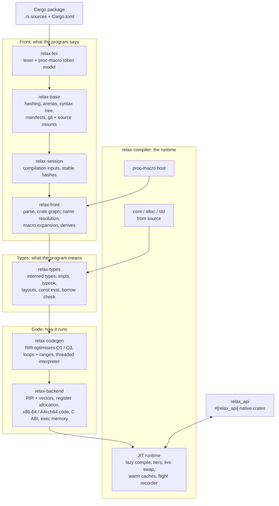

# Relax

**A live compiler and JIT runtime for Rust, written in Rust.**

Relax runs a Cargo package straight from its source. It doesn't use rustc, LLVM or a linker. It
parses, expands, type-checks and borrow-checks your crates itself, compiles each function to machine
code the first time it is called, keeps optimising the hot ones in the background, and swaps in new
code while the program keeps running when you edit a file.

<table>
<tr>
<td align="center"><b>438k</b><br/>lines of Rust: the whole compiler and runtime</td>
<td align="center"><b>0</b><br/>crates.io dependencies</td>
<td align="center"><b>2</b><br/>native back ends: x86-64 and AArch64</td>
<td align="center"><b>134k</b><br/>lines of <code>core</code> / <code>alloc</code> / <code>std</code> it compiles itself</td>
</tr>
<tr>
<td align="center"><b>2.8M</b> lines<br/>parsed in <b>4 s</b></td>
<td align="center"><b>1.06×</b><br/>rustc release (LLVM) run time on its benchmark chart</td>
<td align="center"><b>~0.1 s</b><br/>warm relaunch of an unchanged program</td>
<td align="center"><b>96</b><br/>end-to-end test packages</td>
</tr>
</table>

---

## What it does

| | |
| --- | --- |
| **Boots from source** | Reads `Cargo.toml`, resolves the crate graph (path, git, registry and vendored crates) and starts `main` with no native build of your code. A small app starts cold in about 3 s; a large 3D game reaches its first frame cold in about 13 s. |
| **Checks before it runs** | Your crates are parsed, macro-expanded, type-checked and borrow-checked before the first call. Relax never runs code it hasn't checked. |
| **Compiles lazily, in tiers** | A function is compiled the first time it is called. Hot functions move up in the background: threaded interpreter → O1 → O3. `#[relax(O2)]` / `#[relax(O3)]` ask for a level ahead of the first call; under rustc the attribute does nothing. |
| **Live edits** | Save a file and the functions whose source changed are rechecked, recompiled and swapped in while the program runs. Code already handed out stays valid, and a change that can't be swapped restarts the program in place. |
| **Warm caches** | Every result is cached under the hashes of its inputs. A second start of an unchanged package recompiles nothing, and a cache can never hand back stale code. |
| **Procedural macros** | Proc macros run too: macros that match a natively linked build run natively, and the rest run on the JIT. |
| **Its own std** | `core`, `alloc` and `std` are compiled from source by Relax itself. |
| **Native interop** | Crates that must stay native (OS layers, GPU, audio) export an interface with `#[relax_api]`. JIT code calls them through the C ABI planner, with per-thread heap routing across the boundary. |
| **Built to be inspected** | Compile phases, stalls and tier changes go to a flight recorder, with hitch events and compile profilers, so the runtime can always say what it is doing and why. |

---

## Architecture

Relax is a stack of layers. Each layer builds only on the ones below it and re-exports them, so every
module is `crate::<module>` at every layer. Each layer is its own crate, so they compile in parallel
and a change in an upper layer never rebuilds the ones below.



### The layers

| Crate | Path | Role |
| --- | --- | --- |
| `relax-lex` | `libs/relax/lex` | The one lexer and token model for Rust (every edition), and the token model procedural macros see. Std only. |
| `relax-base` | `libs/relax/base` | What every phase shares: fxhash/sip hashing, memory accounting and zone allocation, clocks, concurrent containers and arenas, the syntax tree, `cfg`, manifests (TOML, resolution), the git read path and source mounts. |
| `relax-session` | `libs/relax/session` | The inputs of a compilation and their stable hashing: the keys every cache is built on. |
| `relax-front` | `libs/relax/front` | Parsing, the crate graph and name resolution, macro expansion (`macro_rules!`, built-ins, `format_args!`, derives, proc-macro registration) and immutable source contexts. |
| `relax-types` | `libs/relax/types` | Interned types, signatures and impls, type checking, layouts, constant evaluation, the borrow checker, per-definition body queries and stable type hashes. |
| `relax-codegen` | `libs/relax/codegen` | The middle end on RIR (Relax IR): the O1 and O3 optimisers (inlining, folding, loop and range passes), the threaded interpreter tier and the compile profilers. |
| `relax-backend` | `libs/relax/backend` | The low-level back end: RIR with vector registers, register allocation, machine code for the host (x86-64 or AArch64), jump tables, the C ABI planner and executable memory. |
| `relax-compiler` | `libs/relax/compiler` | The compiler, JIT runtime and std as one library: lazy compilation, tiering, live edits, caches, the proc-macro host and the test runner. |
| `relax-native-macros` | `libs/relax/native_macros` | Natively linked procedural macros, checked against their source so they expand exactly as they would under Cargo. |
| attribute | `libs/relax/attr` | `#[relax(O2)]` / `#[relax(O3)]`: the optimisation-level attribute; a no-op under rustc. |
| `relax_api` | `libs/relax_api` | `#[relax_api]`: the interface a natively compiled crate offers to JIT code, and the per-thread heap routing shared by the compiler and the generated wrappers. |

### A function's life

```mermaid
sequenceDiagram
    participant App as Running program
    participant RT as JIT runtime
    participant TY as Types layer
    participant CG as Codegen + backend

    Note over RT,TY: before the first call: every crate of the program is type-checked
    App->>RT: first call of fn f
    RT->>CG: compile f (interpreter / O1)
    CG-->>RT: machine code, published
    RT-->>App: call proceeds
    loop while f is hot
        RT->>CG: recompile f at O3 in the background
        CG-->>RT: faster code, swapped in
    end
    Note over App,RT: you save a change to f
    RT->>TY: recheck what changed
    TY-->>RT: ok
    RT->>CG: recompile f
    CG-->>RT: new code; old code stays valid
    RT-->>App: next call runs the new f
```

### Design rules

- **Checked, then run.** Code is type-checked before it is executed; nothing runs unchecked.
- **Never stale.** Every cached result is keyed by the hashes of its inputs. A cache hit is the code
  a fresh compile would produce, or there is no hit.
- **Code only grows.** Published machine code is never freed or rewritten while it can still be on a
  stack; a swap publishes new code and redirects future calls.
- **Lazy by default.** Nothing is compiled until it is needed, and optimisation runs in the background.
- **Rust as written.** Relax compiles ordinary Rust crates, including their dependencies from
  crates.io and git. `libs/relax/KNOWN_GAPS.md` lists what doesn't work yet.
- **Inspectable.** Every phase reports what it is doing; a stall can always be explained from its record.

---

## Building

Relax needs only a stable Rust toolchain and pulls nothing from crates.io.

```sh
cargo build --release -p relax-compiler
```

Relax is a library: a host tool embeds `relax_compiler` and drives it.

## Repository layout

```
Cargo.toml                              the workspace
libs/relax/
  lex/ base/ session/ front/ types/     front end and type system
  codegen/ backend/                     middle end and machine code
  compiler/                             runtime, std (compiler/std), tests, benches
  attr/ native_macros/                  #[relax(..)] and native proc macros
  KNOWN_GAPS.md                         what isn't supported yet
libs/relax_api/                         #[relax_api] and per-thread heap routing
libs/ platform/ tools/ widgets/         the small support crates Relax links: token model,
                                        serialisation, remote inspection, profiling, and the
                                        native proc macros it checks against their source
```

## License

MIT, see [LICENSE](LICENSE). The std sources Relax compiles carry their own notices; see
`libs/relax/compiler/std/CREDITS.md` and the license files beside them.
