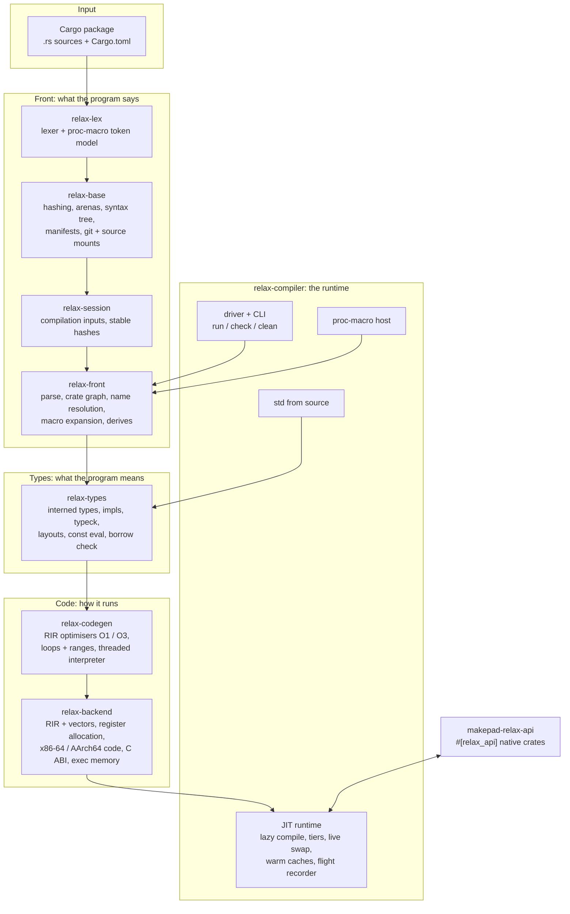

# Relax

**A live compiler and JIT runtime for Rust, written in Rust.**

Relax runs a Cargo package straight from its source. It doesn't use rustc or LLVM and doesn't link a
binary first. It parses and type-checks your crates itself, compiles functions to machine code the
first time they are called, and swaps in new code while the program keeps running when you edit a
file. It is the engine behind Makepad's development loop: apps start in seconds, and a code change
reaches the running app without a restart.

```
makepad run [opts] <package> [cargo flags] [-- args]   boot a cargo package from source
makepad file <path> [edition]                          parse one file, report errors
makepad parse <units.json> [threads]                   parse a crate graph and time it
makepad clean [-p <package>]                           drop the workspace's (or one app's) compiled files
```

---

## What it does

| | |
| --- | --- |
| **Boots from source** | Reads `Cargo.toml`, resolves the crate graph (path, git, registry and vendored crates) and starts `main` without a native build of your code. |
| **Checks before it runs** | Your crates are parsed, macro-expanded, type-checked and borrow-checked before the first call. Relax never runs code it hasn't checked. |
| **Compiles lazily** | A function is compiled when it is first called. Hot functions move up the tiers in the background: threaded interpreter, then O1, then O3. `#[relax(O2)]` / `#[relax(O3)]` ask for a level ahead of the first call; under rustc the attribute does nothing. |
| **Live edits** | Save a file and the functions whose source changed are rechecked, recompiled and swapped in while the program runs. Code already handed out stays valid (JIT code only grows), and a change that can't be swapped restarts the program in place. |
| **Warm caches** | Results are cached by the hashes of their inputs, so a second start of an unchanged package does no recompiling, and a cache can never hand back stale code. |
| **Proc macros** | Procedural macros run too: macros that match a natively linked build run natively, and the rest run on the JIT host. |
| **Its own std** | `core`, `alloc` and `std` are compiled from source by Relax itself (see `libs/relax/compiler/std/CREDITS.md`). |
| **Native interop** | Crates that must stay native (platform layers, GPU, audio) export an interface with `#[relax_api]`; JIT code calls them through the C ABI planner, with per-thread heap routing (`makepad-alloc-phase`). |
| **Built to be inspected** | Compile phases, stalls and tier changes are recorded (a flight recorder, hitch events, compile profilers), so you can always ask the runtime what it is doing and why. |

---

## Architecture

Relax is a stack of layers. Each layer builds only on the ones below it and re-exports them, so every
module is `crate::<module>` at every layer.



### The layers

| Crate | Path | Role |
| --- | --- | --- |
| `relax-lex` | `libs/relax/lex` | The one lexer and token model for Rust (every edition) plus the `.rx` dialect modes; also the token model procedural macros see. Std only. |
| `relax-base` | `libs/relax/base` | What every phase shares: fxhash/sip hashing, memory accounting and zone allocation, clocks, concurrent containers and arenas, the syntax tree, `cfg`, manifests (TOML, resolution), the git read path and source mounts. |
| `relax-session` | `libs/relax/session` | The inputs of a compilation and their stable hashing: the keys every cache is built on. |
| `relax-front` | `libs/relax/front` | Parsing, the crate graph and name resolution, macro expansion (`macro_rules!`, built-ins, `format_args!`, derives, proc-macro registration) and immutable source contexts. |
| `relax-types` | `libs/relax/types` | Interned types, signatures and impls, type checking, layouts, constant evaluation, the borrow checker, per-definition body queries and stable type hashes. |
| `relax-codegen` | `libs/relax/codegen` | The middle end on RIR (Relax IR): the O1 and O3 optimisers (inlining, folding, loop and range passes), the threaded interpreter tier and the compile profilers. |
| `relax-backend` | `libs/relax/backend` | The shared low-level back end: RIR with vector registers, register allocation, machine code for the host (x86-64 or AArch64), jump tables, the C ABI planner and executable memory. Also compiles Splash shader kernels. |
| `relax-compiler` | `libs/relax/compiler` | The compiler, JIT runtime and std as one library, plus the command-line driver. Owns lazy compilation, tiering, live edits, caches, the proc-macro host and the test runner. |
| `makepad-relax` | `libs/relax/attr` | `#[relax(O2)]` / `#[relax(O3)]`: the optimisation-level attribute; a no-op under rustc. |
| `relax-native-macros` | `libs/relax/native_macros` | Native procedural-macro support. |
| `makepad-relax-api` | `libs/relax_api` | `#[relax_api]`: the interface a natively compiled crate offers to Relax-compiled code (`macro`, `macro_impl`), and `makepad-alloc-phase`, per-thread heap routing shared by the compiler and the generated wrappers. |

### A function's life

```mermaid
sequenceDiagram
    participant App as Running program
    participant RT as JIT runtime
    participant TY as Types layer
    participant CG as Codegen + backend

    Note over RT,TY: before the first frame: every crate of the app is type-checked
    App->>RT: first call of fn f
    RT->>CG: compile f (interpreter / O1)
    CG-->>RT: machine code, published
    RT-->>App: call proceeds
    loop hot
        RT->>CG: recompile f at O3 in the background
        CG-->>RT: faster code, swapped in
    end
    Note over App,RT: you save a change to f
    RT->>TY: recheck what changed
    TY-->>RT: ok
    RT->>CG: recompile f
    CG-->>RT: new code; old code stays valid
    RT-->>App: next call runs the new f
```

### Design rules

- **Checked, then run.** Code is type-checked before it is executed; nothing runs unchecked.
- **Never stale.** Every cached result is keyed by the hashes of its inputs. A cache hit is the same
  code a fresh compile would produce, or there is no hit.
- **Code only grows.** Published machine code is never freed or rewritten while it can still be on a
  stack; a swap publishes new code and redirects future calls.
- **Lazy by default.** Nothing is compiled until it is needed. Optimisation runs in the background.
- **Rust as written.** Relax compiles ordinary Rust crates, including their dependencies from
  crates.io and git. `KNOWN_GAPS.md` lists what doesn't work yet.
- **Inspectable.** Every phase reports what it is doing; a stall can always be explained from its record.

---

## Repository layout

```
libs/relax/
  lex/ base/ session/ front/ types/     front end and type system
  codegen/ backend/                     middle end and machine code
  compiler/                             runtime, driver, std (compiler/std), tests, benches
  attr/ native_macros/                  #[relax(..)] and native macro support
  KNOWN_GAPS.md                         what isn't supported yet
  CONTRIBUTING.md                       how to work on Relax
libs/relax_api/                         #[relax_api] and makepad-alloc-phase
```

The paths match the [Makepad repository](https://github.com/makepad/makepad), where Relax is developed
and built as part of the Makepad workspace. This repository is a source export of those two
directories.

## Status

Relax runs the Makepad apps and its own test suite (the packages under
`libs/relax/compiler/tests`) on x86-64 and AArch64 hosts. `KNOWN_GAPS.md` lists the known
gaps.

## License

MIT, see [LICENSE](LICENSE). The std sources compiled by Relax carry their own notices; see
`libs/relax/compiler/std/CREDITS.md` and the license files beside them.
