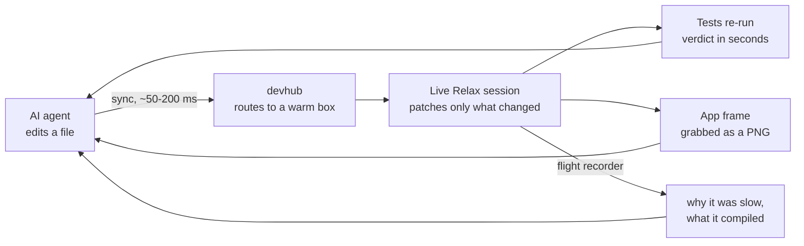
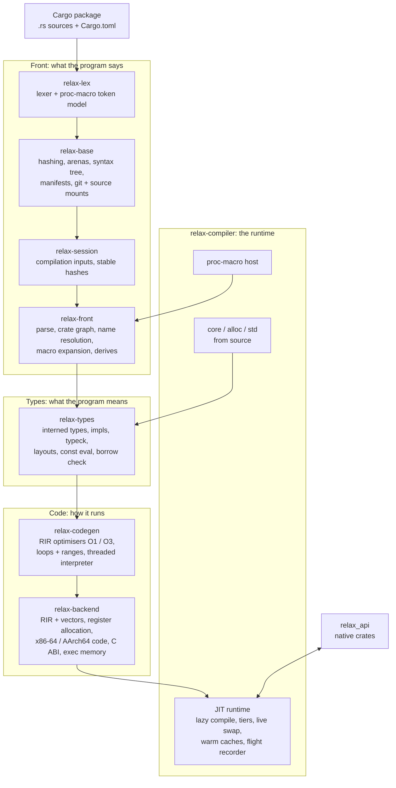
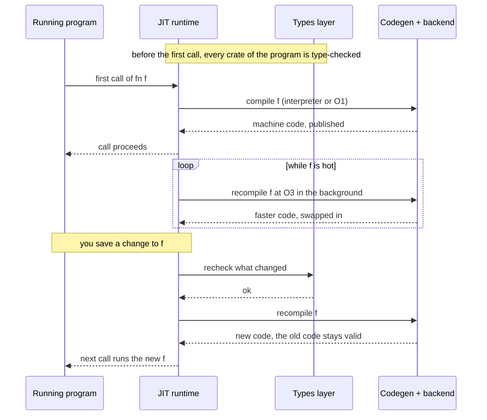

# Relax

### Rust without the wait.

**Relax is a live compiler and JIT runtime for Rust, written in Rust.** It runs your Cargo package
straight from source: no rustc, no LLVM, no linker in the loop. It checks your code, compiles each
function the moment it is first called, optimises the hot ones while your program runs, and patches
new code into the running process when you save a file.

Rust gives you speed and safety, and charges for them in compile times. Relax takes the compile out of
the loop. You keep the language, the crates, the type system and the borrow checker, and you lose the
wait.

## Relax vs rustc

| | rustc + Cargo | **Relax** |
| --- | --- | --- |
| **Large 3D game, clean checkout → first frame** | ~3 min build, then start | **13 s**, straight from source |
| **Change one function in a running program** | rebuild, relink, restart: program state lost | **patched into the running process**: state kept |
| **Save a file → 92 tests re-run** | rebuild the test binary first | **2.2 s** after the save |
| **Relaunch an unchanged program** | no-op build check, then start | **~0.1 s** from a warm cache |
| **Speed of optimised code** | 1.00× (LLVM release) | **1.06×** on the benchmark chart (1.24× on the hardest workload we track) |
| **Type- and borrow-checked before it runs** | yes | **yes** |
| **Needs** | rustc, LLVM, a linker | **Relax**, one Rust library (438k lines, 0 crates.io dependencies) |

---

## Why this changes Rust

**The edit-compile-run loop is Rust's biggest tax.** A change to one function rebuilds crates,
relinks binaries and restarts your program, so you lose its state and your flow. On a large app that
is minutes, many times a day.

**Relax replaces the loop with a live program.**

- **It starts from source, now.** No native build stands between you and `main`. A small app boots
  cold in about 3 s; a large 3D game reaches its first frame in about 13 s, where a clean release
  build takes about 3 minutes.
- **Saving is the build.** Only the functions whose source changed are rechecked and recompiled, and
  they are swapped into the running process. The program keeps its state, windows and connections.
- **It is fast where it counts.** Code starts on a threaded interpreter and climbs to O1 and O3 in the
  background while it runs. On its benchmark chart, optimised Relax code runs at 1.06× rustc release
  time. On the hardest workload we track it is 1.24×, and that gap is being closed.
- **It is still Rust.** Ordinary crates, from path, git, crates.io and vendored sources, with their
  macros, procedural macros included. Every crate is type-checked and borrow-checked before its first
  call: Relax never runs code it hasn't checked.
- **It never hands you stale code.** Every cached result is keyed by the hashes of its inputs. A warm
  start recompiles nothing, and a cache hit is exactly what a fresh compile would produce.

**Built for machines as much as people.** An AI agent can't feel a slow build, but it pays for every
one: in tokens, wall-clock and context. Relax turns "edit, wait, look" into "edit, look", and every
phase reports what it is doing, so an agent can always ask the runtime what happened and why.

---

## Relax at work: an AI development loop that stays hot

[Makepad](https://github.com/makepad/makepad) builds its apps with many AI agents working in parallel,
each in its own lane, and Relax is what makes that loop fast. Makepad's dev hub, **devhub**, runs the
fleet of build and test machines around Relax so that nothing an agent touches is ever cold.



**What keeps it hot**

- **Live sessions per lane.** Each agent's app or test run stays alive under Relax on a pool machine.
  A save syncs to it in tens of milliseconds and patches the running process. No rebuild, no relaunch.
- **Tests as a live verdict.** The same warm process re-runs the affected tests after each patch: 92
  tests came back 2.2 s after the save that changed them.
- **Warm caches everywhere.** Each machine keeps a warm Relax cache at the tip of the main branch and
  refreshes it as changes land, so a new lane or a fresh worker starts warm, not cold.
- **Restart in place.** When an edit changes a type's layout in a way that can't be patched, the
  session restarts itself in place and keeps going. The agent sees a line in its log, not an error.
- **No native builds in the loop.** devhub sends iteration and pre-landing checks to Relax. Native
  builds are kept for baselines and timed benchmarks, and the scheduler counts every native build
  that slips through, per lane.
- **Measured routing.** Jobs are sized by their measured times. Small jobs go to "hot" machines with
  warm sessions, and big ones to the pool, so an agent's quick check never queues behind a long build.
- **Answers, not logs.** When a frame hitches, Relax's flight recorder says which thread waited, on
  what, and which function was compiling. Agents use it to find their own stalls.

**In practice:** nine agent lanes run side by side, devhub handles more than 300 build and test jobs an
hour, and dozens of changes land every day, each checked under Relax before it merges.

---

## What it does

| | |
| --- | --- |
| **Boots from source** | Reads `Cargo.toml`, resolves the crate graph (path, git, registry and vendored crates) and starts `main` with no native build of your code. |
| **Checks before it runs** | Your crates are parsed, macro-expanded, type-checked and borrow-checked before the first call. |
| **Compiles lazily, in tiers** | A function is compiled the first time it is called. Hot functions move up in the background: threaded interpreter → O1 → O3. `#[relax(O2)]` / `#[relax(O3)]` ask for a level ahead of the first call; under rustc the attribute does nothing. |
| **Live edits** | Save a file and the functions whose source changed are rechecked, recompiled and swapped in while the program runs. Code already handed out stays valid. A change that can't be swapped restarts the program in place. |
| **Warm caches** | Every result is cached under the hashes of its inputs. A second start of an unchanged package recompiles nothing. |
| **Procedural macros** | Proc macros run too: macros that match a natively linked build run natively, and the rest run on the JIT. |
| **Its own std** | `core`, `alloc` and `std` (134k lines) are compiled from source by Relax itself. |
| **Native interop** | Crates that must stay native (OS layers, GPU, audio) export an interface with `#[relax_api]`. JIT code calls them through the C ABI planner, with per-thread heap routing across the boundary. |
| **Built to be inspected** | Compile phases, stalls and tier changes go to a flight recorder, with hitch events and compile profilers. |

---

## Architecture

Relax is a stack of layers. Each layer builds only on the ones below it and re-exports them, so every
module is `crate::<module>` at every layer. Each layer is its own crate, so they compile in parallel,
and a change in an upper layer never rebuilds the ones below.



### The layers

| Crate | Path | Role |
| --- | --- | --- |
| `relax-lex` | `libs/relax/lex` | The one lexer and token model for Rust (every edition), and the token model procedural macros see. Std only. |
| `relax-base` | `libs/relax/base` | What every phase shares: fxhash/sip hashing, memory accounting and zone allocation, clocks, concurrent containers and arenas, the syntax tree, `cfg`, manifests (TOML, resolution), the git read path and source mounts. |
| `relax-session` | `libs/relax/session` | The inputs of a compilation and their stable hashing: the keys every cache is built on. |
| `relax-front` | `libs/relax/front` | Parsing, the crate graph and name resolution, macro expansion (`macro_rules!`, built-ins, `format_args!`, derives, proc-macro registration) and immutable source contexts. |
| `relax-types` | `libs/relax/types` | Interned types, signatures and impls, type checking, layouts, constant evaluation, the borrow checker, per-definition body queries and stable type hashes. |
| `relax-codegen` | `libs/relax/codegen` | The middle end on RIR (Relax IR): the O1 and O3 optimisers (inlining, folding, loop and range passes), the threaded interpreter tier and the compile profilers. |
| `relax-backend` | `libs/relax/backend` | The low-level back end: RIR with vector registers, register allocation, machine code for the host (x86-64 or AArch64), jump tables, the C ABI planner and executable memory. |
| `relax-compiler` | `libs/relax/compiler` | The compiler, JIT runtime and std as one library: lazy compilation, tiering, live edits, caches, the proc-macro host and the test runner. |
| `relax-native-macros` | `libs/relax/native_macros` | Natively linked procedural macros, checked against their source so they expand exactly as they would under Cargo. |
| attribute | `libs/relax/attr` | `#[relax(O2)]` / `#[relax(O3)]`: the optimisation-level attribute; a no-op under rustc. |
| `relax_api` | `libs/relax_api` | `#[relax_api]`: the interface a natively compiled crate offers to JIT code, and the per-thread heap routing shared by the compiler and the generated wrappers. |

### A function's life



### Design rules

- **Checked, then run.** Code is type-checked before it is executed; nothing runs unchecked.
- **Never stale.** Every cached result is keyed by the hashes of its inputs. A cache hit is the code a
  fresh compile would produce, or there is no hit.
- **Code only grows.** Published machine code is never freed or rewritten while it can still be on a
  stack; a swap publishes new code and redirects future calls.
- **Lazy by default.** Nothing is compiled until it is needed, and optimisation runs in the background.
- **Rust as written.** Relax compiles ordinary Rust crates, including their dependencies from crates.io
  and git. `libs/relax/KNOWN_GAPS.md` lists what doesn't work yet.
- **Inspectable.** Every phase reports what it is doing; a stall can always be explained from its record.

---

## Building

Relax needs only a stable Rust toolchain and pulls nothing from crates.io.

```sh
cargo build --release -p relax-compiler
```

Relax is a library: a host tool embeds `relax_compiler` and drives it.

## Repository layout

```
Cargo.toml                              the workspace
libs/relax/
  lex/ base/ session/ front/ types/     front end and type system
  codegen/ backend/                     middle end and machine code
  compiler/                             runtime, std (compiler/std), 96 end-to-end test packages, benches
  attr/ native_macros/                  #[relax(..)] and native proc macros
  KNOWN_GAPS.md                         what isn't supported yet
libs/relax_api/                         #[relax_api] and per-thread heap routing
libs/ platform/ tools/ widgets/         the small support crates Relax links: token model,
                                        serialisation, remote inspection, profiling, and the
                                        native proc macros it checks against their source
```

## License

MIT, see [LICENSE](LICENSE). The std sources Relax compiles carry their own notices; see
`libs/relax/compiler/std/CREDITS.md` and the license files beside them.
